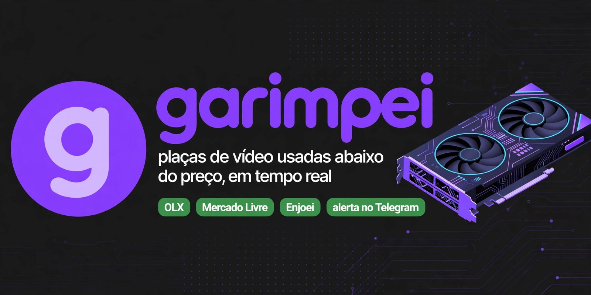

**Achou, garimpei!** ⛏️

---

### 🔎 O que é o Garimpei

Placa de vídeo boa e barata some em minutos. O Garimpei varre os **principais sites de anúncios do Brasil** a cada minuto,
compara cada anúncio com o **preço real de mercado** do modelo e avisa no Telegram, com o link direto, em segundos.

| | |
|---|---|
| 🔥 **Garimpo** | 25% ou mais abaixo do preço normal |
| 💎 **Bom preço** | entre 12% e 25% abaixo |
| ✅ **Preço justo** | dentro do mercado |
| ⚠️ **Suspeito** | barato demais: golpe, defeito ou só a caixa |

### 🎯 Para quem quer comprar

- **RTX 3060, 4060, 4070, 5060, 5070**, RX 6600 e mais de 40 modelos
- **Termômetro de preço**: menor preço e mediana dos últimos 30 dias de cada placa
- **Radar pessoal**: "me avisa quando aparecer RTX 4060 até R$ 1.500 em SP"
- **Cupons** de lojas de informática garimpados o dia todo

### 💳 Planos

| Plano | Acesso | Preço |
|---|:---:|:---:|
| 1 dia | 24 horas | R$ 9,99 |
| 7 dias | 7 dias | R$ 29,90 |
| **30 dias** ⭐ | 30 dias | **R$ 59,90** |
| 90 dias | 90 dias | R$ 149,90 |
| 1 ano | 365 dias | R$ 479,90 |

PIX com liberação na hora · sem renovação automática · entrada no canal VIP aprovada pelo bot após o pagamento.

### ⚙️ Como é feito

Serverless na borda · banco com RLS · tempo real com Supabase Realtime · rate limit e proteção anti-SSRF · zero servidor para manter.

---

O Garimpei não é afiliado aos sites de anúncios. A compra é feita direto com o vendedor — use sempre o pagamento protegido de cada plataforma.
